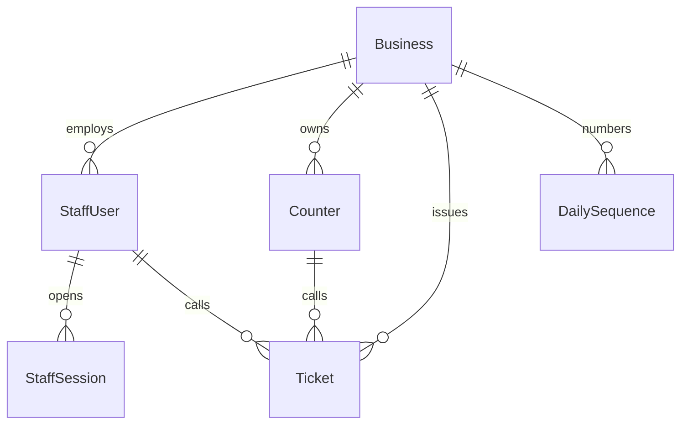

# Design

## Context

Greenfield Next.js (App Router) + React + TypeScript project with no existing code or specs. See `proposal.md` for motivation and `specs/` for the behavior contract. The design assumes a single Next.js deployment backed by one relational database; every business is a tenant row, not a separate deployment.

## Goals / Non-Goals

**Goals:**

- Correct ordering and atomic ticket claiming under concurrent counters.
- Tenant isolation enforced at the data-access layer, not only in the UI.
- Per-business day boundaries driven by a configured timezone, with no scheduled jobs.
- Minimal operational surface: one app process, one database.

**Non-Goals:**

- Horizontal scaling, sharding, or per-tenant databases.
- Counter exclusivity (locking a counter to one console) or presence/heartbeat.
- Any behavior listed under "Out of Scope" in the proposal.

## Decisions

### Persistence: PostgreSQL + Prisma

Relational constraints do most of the concurrency work here: a partial unique index can enforce "one CALLED ticket per counter", and an upsert can allocate daily numbers atomically. SQLite was rejected because its single-writer locking and weaker partial-index ergonomics would hide concurrency bugs that reappear in production. Redis-only was rejected because tickets and served history must be durable.

### Data model



- `Business(id, slug UNIQUE, name, timezone)`
- `StaffUser(id, businessId, email UNIQUE, passwordHash)`
- `StaffSession(id, tokenHash UNIQUE, staffUserId, counterId NULL, expiresAt)`
- `Counter(id, businessId, name, UNIQUE(businessId, name))`
- `DailySequence(businessId, serviceDate, lastSeq, PRIMARY KEY(businessId, serviceDate))`
- `Ticket(id, publicTokenHash UNIQUE, businessId, serviceDate, seq, status, counterId NULL, calledByStaffId NULL, calledAt, servedAt)`
  - `UNIQUE(businessId, serviceDate, seq)`
  - `CREATE UNIQUE INDEX ... ON Ticket(counterId) WHERE status = 'CALLED'`
  - `INDEX(businessId, serviceDate, status, seq)`

`serviceDate` is computed once per request in SQL as `(now() AT TIME ZONE business.timezone)::date` and stored on the ticket, so historical days never shift with timezone changes.

### Atomic number allocation

One statement per issuance, inside the same transaction as the ticket insert:

```sql
INSERT INTO DailySequence (businessId, serviceDate, lastSeq)
VALUES ($1, $2, 1)
ON CONFLICT (businessId, serviceDate)
DO UPDATE SET lastSeq = DailySequence.lastSeq + 1
RETURNING lastSeq;
```

A serializable transaction with retries was rejected: the upsert already serializes on one row and needs no retry loop.

### Atomic call-next

The counter's current ticket is checked first, then one statement claims the oldest waiting ticket:

```sql
UPDATE Ticket
SET status = 'CALLED', counterId = $counter, calledAt = now()
WHERE id = (
  SELECT id FROM Ticket
  WHERE businessId = $b AND serviceDate = $day AND status = 'WAITING'
  ORDER BY seq
  LIMIT 1
  FOR UPDATE SKIP LOCKED
)
RETURNING *;
```

The partial unique index on `(counterId) WHERE status = 'CALLED'` is a second line of defense: a duplicate call from a raced console fails with a unique violation, mapped to a conflict response. No distributed lock or queue broker is needed.

### Authentication and tenancy

- Email/password with Argon2id (`@node-rs/argon2`); no NextAuth, which would add providers and callbacks the feature does not use.
- Opaque 32-byte session token in an `HttpOnly`, `Secure`, `SameSite=Lax` cookie; SHA-256 hash stored in `StaffSession`. 12-hour fixed expiry, renewed on login only.
- The selected counter is stored on the session server-side and revalidated against the session's business on every call, so a client cannot spoof another business's counter.
- Every query filters by the session's `businessId`; authorization is checked in route handlers, not middleware, because every staff action already needs a database read.

### Ticket token

Ticket URLs use 128 bits from `crypto.randomBytes(16)` encoded as base64url. Only the SHA-256 hash is stored. The URL is the sole credential, so responses set `Cache-Control: no-store` and `Referrer-Policy: no-referrer`; the ticket page loads no third-party resources.

### HTTP surface

- `POST /api/queue/[slug]/tickets` — issue ticket.
- `GET /api/tickets/[token]` — number, status, position, counter name, timestamps.
- `POST /api/staff/login`, `POST /api/staff/logout`.
- `POST /api/staff/counter` — set the session's counter.
- `GET /api/staff/state` — current CALLED ticket, waiting count, counter.
- `POST /api/staff/call-next`.
- `POST /api/staff/tickets/[id]/serve`.

Pages: `/q/[slug]` (issue), `/t/[token]` (ticket), `/staff/login`, `/staff` (console). The ticket page and console poll every 1 second, pause while the tab is hidden, and the ticket page stops at terminal states. Both pages server-render their initial data, so the first paint already shows the ticket or console state instead of a loading placeholder.

### Round-trip budget

Each hot path is one SQL statement: issuance uses a data-modifying CTE for the sequence and ticket, ticket lookup computes position in the same query, call-next claims and joins its counter in one statement, serve is one conditional update, and the staff console loads session, counters, current ticket, and waiting count together. This keeps the app responsive when the database is remote; the polling interval is one second because each poll costs one query.

### Expiry without cron

A ticket is expired when `serviceDate < current business day` and status is not `SERVED`. Expiry is derived at read time and never written, so no job runs at midnight. A ticket already CALLED before midnight can still be marked served afterwards.

## Risks / Trade-offs

- Two staff can select the same counter (no lock) → calls stay attributed and consistent, but the console may show another staff member's active ticket; accepted for core scope, exclusivity needs presence/heartbeat later.
- A counter whose CALLED ticket is never served stays blocked → partial index rejects further calls; serving remains possible after rollover, and no auto-expiry is in scope.
- Polling produces one request per open page per second → each poll is a single indexed query and hidden tabs pause; a notification push channel was not chosen.
- Ticket URL leakage through history, screenshots, or shared links → treated as bearer credential; hash-at-rest plus `no-referrer` limits exposure, but the holder can always view the ticket.
- Midnight rollover during service → ticket keeps its issue day; only "callable" is gated by day, so in-flight service completes normally.
- Day computation depends on the business's IANA timezone string → validate timezone on write; test a DST transition.

## Migration Plan

Greenfield: apply one Prisma migration, seed one demo business with counters and a staff account, then deploy. Rollback is dropping the schema; there is no production data to preserve.

## Open Questions

- Hosting and managed Postgres provider are undecided and do not affect the specs or task breakdown.
