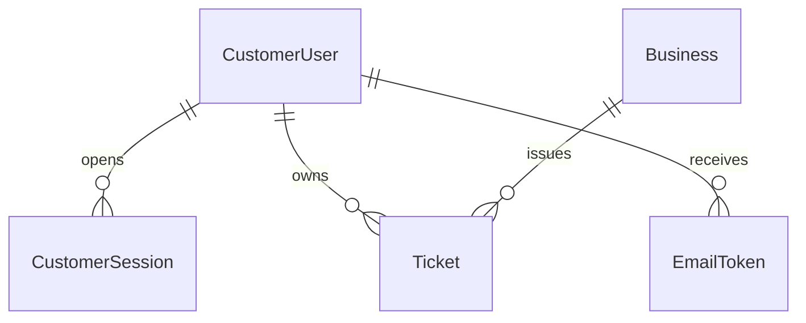

# Design

## Context

See `proposal.md` for motivation and the deltas under `specs/` for the behavior contract. The current app issues anonymous bearer-URL tickets (`queue/ticketing`), authenticates staff with Argon2id plus server-side sessions (`src/lib/auth.ts`), and reaches a remote Supabase Postgres where each query costs roughly 250 ms. The round-trip budget from the archived `add-core-queue-flow` design still applies: hot paths should stay at one SQL statement.

## Goals / Non-Goals

**Goals:**

- A durable customer identity and a 30-day session that survives browser restarts.
- Ticket ownership enforced server-side, never inferred from the URL.
- One active ticket per customer per business day, safe under concurrent requests.
- Email verification and password reset with single-use, expiring tokens.
- Keep staff and customer authorization completely separate.

**Non-Goals:**

- Notification delivery when a ticket is called.
- Phone/SMS, OAuth, passkeys, or account deletion/export.
- Claiming or displaying legacy anonymous tickets.
- Preventing multiple accounts per person.

## Decisions

### Data model



- `CustomerUser(id, email UNIQUE, passwordHash, emailVerifiedAt NULL, createdAt)`
- `CustomerSession(id, tokenHash UNIQUE, customerUserId, expiresAt, createdAt)`
- `EmailToken(id, tokenHash UNIQUE, customerUserId, purpose, expiresAt, usedAt NULL, createdAt)`
- `Ticket.customerId STRING NULL` (nullable only for legacy rows) with `ON DELETE SET NULL`.
- Index `Ticket(customerId, businessId, serviceDate, status)`.
- Partial unique index for the duplicate rule:
  ```sql
  CREATE UNIQUE INDEX "Ticket_one_active_per_customer_day"
  ON "Ticket" ("customerId", "businessId", "serviceDate")
  WHERE "status" IN ('WAITING', 'CALLED') AND "customerId" IS NOT NULL;
  ```

`email` is stored trimmed and lowercased; uniqueness is global because a person may queue at several businesses with one account.

### Separate customer and staff sessions

Customer sessions use their own table, cookie name (`customer_session`), and resolver. Staff cookie resolution is never attempted on customer routes and vice versa, so a customer session cannot reach a calling endpoint even if cookies are sent to the same origin. Both use 32 random bytes, a SHA-256 hash at rest, `HttpOnly; Secure; SameSite=Lax`, and Argon2id passwords. Customer sessions last 30 days; they are extended when fewer than 23 days remain, avoiding a write on every request. A reset invalidates all of that customer's sessions.

### Email transport

Use Nodemailer over a configured `SMTP_URL` with a `MAIL_FROM` address. This keeps the provider replaceable (SES, Resend SMTP, Postmark) and adds no vendor SDK. When `SMTP_URL` is absent in development, the sender writes the message and link to the server log and still succeeds, so local flows are testable. Email is sent synchronously after the database commit; a failure leaves the account usable and exposes a resend action.

### Verification and reset tokens

Tokens are 256-bit random values; only SHA-256 hashes are stored. Verification lives 24 hours, reset 1 hour, both single-use (`usedAt`). Verification is non-blocking: unverified accounts can sign in and take tickets, and the dashboard shows a notice. Reset requests always answer the same way; a reset invalidates existing sessions.

### Ticket issuance with duplicate control

Issuance is authenticated by the customer session cookie. The session lookup, active-ticket check, daily sequence increment, and insert run as one data-modifying CTE keyed by the session token hash, so a remote database costs one round trip:

1. Resolve the session to a customer; return unauthorized if absent or expired.
2. Resolve the business and its local business day.
3. If a WAITING/CALLED ticket exists for that customer, business, and day, return it with `reused: true` and do not touch the sequence.
4. Otherwise upsert `DailySequence` and insert the ticket with `customerId`.

A concurrent duplicate loses the partial-index race; that unique violation is caught and the existing ticket is fetched and returned. A repeat request returns the account ticket URL, not a new public token, because only the token hash exists.

### Ticket access by account

Ticket pages move to account-scoped URLs: `/account/tickets/[id]`. `/t/[token]` remains the deep-link entry point: it resolves the token, requires a customer session, redirects unauthenticated visitors to sign in with a `next` return path, and responds 404 when the session's customer does not own the ticket. The polling endpoint becomes `GET /api/account/tickets/[id]`, authenticating the session and ticket ownership in a single query; the token is never used as authorization.

Duplicate issuance and the account list therefore link to `/account/tickets/[id]`. Legacy tickets have no owner, so no session can satisfy the ownership check; they remain stored but unreachable.

### Account dashboard

`/account` server-renders the session's active tickets plus tickets served or expired in the last 30 days, newest first, across businesses. It is one SQL query keyed by the session token hash. The dashboard does not poll; each ticket detail page polls every second using the existing hook.

### Queue directory

`/q` is the signed-in entry point for choosing a business. It lists every business and, in the same query keyed by the session token hash, maps the customer's active WAITING/CALLED ticket for that business's current day. A mapped business links to `/account/tickets/[id]`; otherwise the card links to `/q/[slug]`. The landing page points to `/q` instead of a seeded demo slug. This is one query and adds no tables.

### HTTP surface

- `POST /api/account/signup`, `POST /api/account/login`, `POST /api/account/logout`
- `POST /api/account/verify` (resend), `GET /account/verify?token=`
- `POST /api/account/reset/request`, `POST /api/account/reset`
- `POST /api/queue/[slug]/tickets` (now requires a customer session)
- `GET /api/account/tickets/[id]` (authenticated polling)
- Pages: `/account`, `/account/login`, `/account/signup`, `/account/forgot`, `/account/reset`, `/account/tickets/[id]`, `/q` (directory), plus gated `/q/[slug]` and `/t/[token]`.

Auth endpoints apply a per-IP fixed-window limit stored in process memory (single-instance assumption already documented). Mutating requests require a same-origin `Origin` header when present.

### Validation and errors

Signup rejects malformed emails, passwords under 8 characters, and duplicate emails with a sign-in prompt. Sign-in failures stay generic. Reset requests return the same response for known and unknown emails. Ticket and account routes return 401 for a missing/expired session and 404 for another customer's resource, never distinguishing "exists but not yours" from "missing".

## Risks / Trade-offs

- Mandatory signup adds counter friction → 30-day sessions and a returning signup flow keep repeat visits one tap.
- A typo'd email makes the account unrecoverable → verification notice at signup and dashboard; email changes are not in scope.
- Email deliverability and SMTP availability → configurable provider, development log fallback, resend action; no notification channel is added.
- One person can create several accounts to bypass the duplicate rule → per-IP rate limits only; stronger identity is out of scope.
- Legacy anonymous tickets become unreachable → documented breaking migration; tokens are retained but never authorize.
- Customer PII now exists without deletion/export → retention limited to 30 days of history in the UI; account deletion must be added before a public launch requiring it.
- Remote database latency → one-statement issuance, ticket lookup, and dashboard; sessions extended infrequently.

## Migration Plan

Apply one Prisma migration adding the three tables, `Ticket.customerId`, and the partial unique index. No backfill: existing tickets keep `customerId = NULL` and are unreachable through the new ownership checks. Deploy the app and migration together; old ticket links now land on sign-in and resolve to 404. Rollback drops the new tables, column, and index and restores the anonymous ticket routes; no ticket rows are deleted.

## Open Questions

- Which SMTP provider and sending domain to use in production; this is operational and does not change the specs or tasks.
